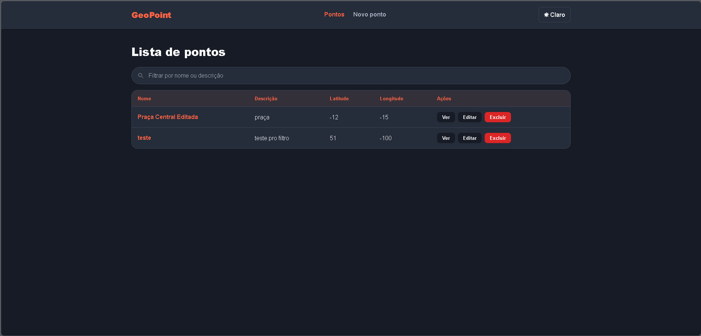
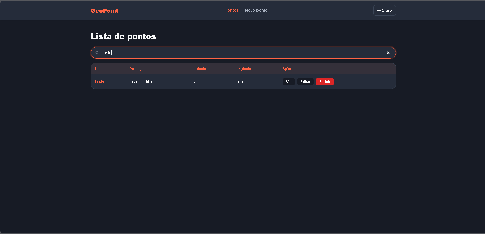
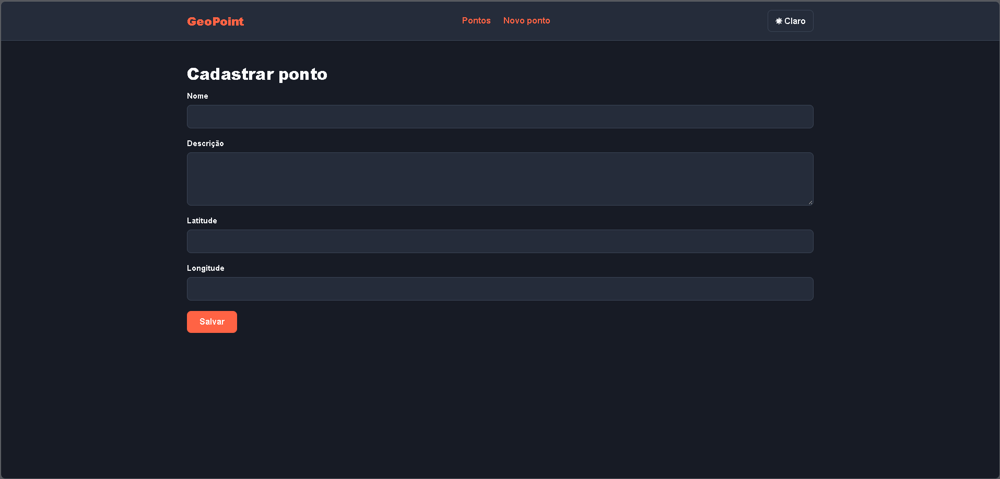
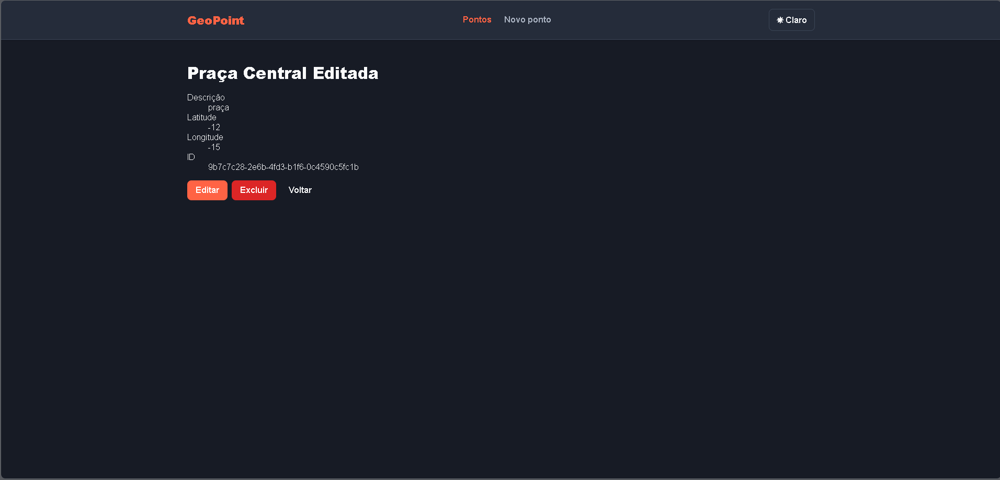

# GeoPoint

Aplicação web para cadastro, consulta, edição e gerenciamento de pontos geográficos.

## Integrantes

- Rodrigo Lordi Carneiro dos Santos RA: 1111500
- Estevan Miotto Bertosso RA: 1139560

## Tecnologias utilizadas

- React
- Vite
- JavaScript
- React Router DOM
- CSS
- Node.js

## Funcionalidades

- Listagem de pontos geográficos.
- Filtro por nome ou descrição.
- Cadastro de novos pontos.
- Visualização dos detalhes de cada ponto.
- Edição de pontos cadastrados.
- Exclusão de pontos.
- Tema claro e escuro.
- Layout responsivo para dispositivos móveis.


## Como executar o projeto

### Pré-requisitos

- Node.js instalado.
- npm instalado.

### 1. Backend (API)

Abra um terminal na pasta `geopoint-api`:

```bash
npm install
npm run dev
```

A API ficará disponível em:

http://localhost:8080

### 2. Frontend

Abra outro terminal na pasta `Trabalho-frontend-GeoPoint`:

```bash
npm install
npm run dev
```

O frontend ficará disponível no endereço informado pelo Vite, normalmente:

http://localhost:5173

## URL da API

A aplicação utiliza a API local:

http://localhost:8080/api/points

## Capturas de tela

### Listagem de pontos


### Filtro de pontos


### Cadastro de pontos


### Detalhes do ponto
